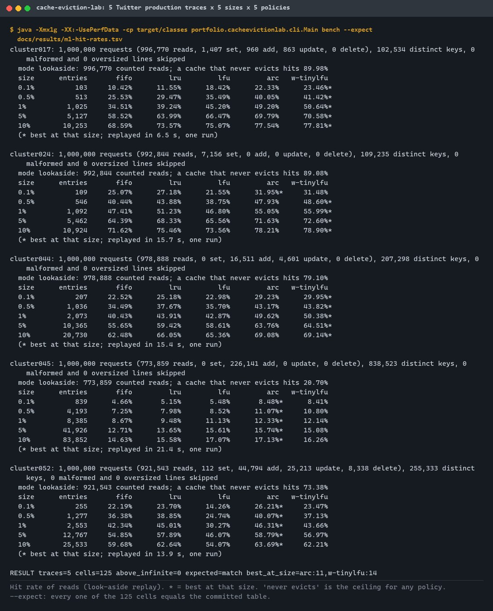
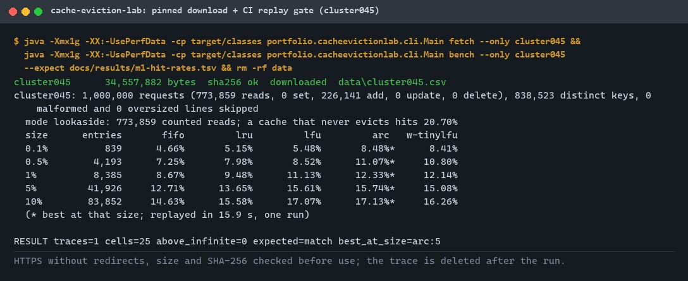
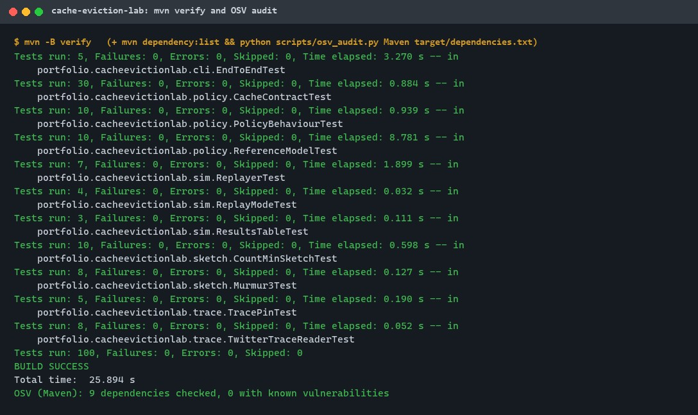
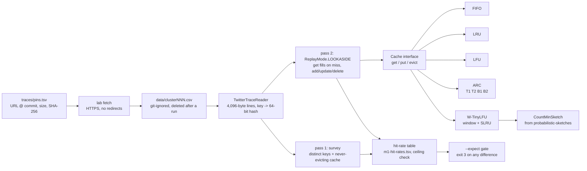
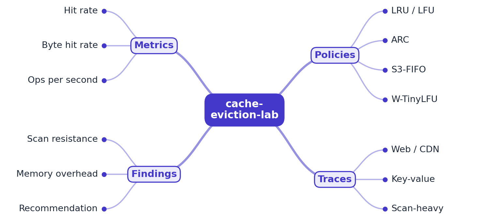
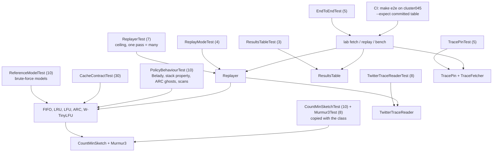

# cache-eviction-lab

[](https://github.com/EquinoxWN/cache-eviction-lab/actions/workflows/ci.yml)


> Which cache policy actually keeps your hit rate up: real production traces replayed through LRU, LFU, ARC and modern policies.

Part of my **Distributed Systems & Storage** list · Java

> Builds on: [probabilistic-sketches](https://github.com/EquinoxWN/probabilistic-sketches) (its Count-Min sketch is W-TinyLFU's admission filter)

## Proof it works

Five Twitter production cache traces (1,000,000 requests each) replayed through FIFO, LRU, LFU,
ARC and W-TinyLFU at 0.1% to 10% of each trace's distinct keys. ARC or W-TinyLFU has the best hit
rate in all 25 trace and size cells, LRU in none; the best policy beats LRU by 0.9 to 11.9 points.
A second run reproduced all 125 cells exactly, and no policy ever beat the cache that never evicts:



The trace is downloaded by its pin (HTTPS, size and SHA-256 checked), replayed, compared with the
committed numbers, then deleted. CI runs this step on every push:



100 tests pass (each policy against a brute-force model on 600,000 random operations first), and no
dependency has a known vulnerability:



## Architecture

**What M1 runs today:**



**Full roadmap (M1 to M3):**



## How it works

_Steps 1 and 2 are built and tested (M1), and the W-TinyLFU half of step 4; the rest is on the [roadmap](#roadmap)._

1. Every policy implements the same Cache interface (get, put, evict), so they swap without changing the harness.
2. The harness streams public production traces and replays each one at several cache sizes.
3. It records hit rate, byte hit rate and throughput per policy per size.
4. W-TinyLFU uses the Count-Min sketch from probabilistic-sketches as its admission filter; S3-FIFO uses small, main and ghost queues.
5. A scan-heavy trace shows LRU collapsing while scan-resistant policies hold their hit rate.
6. Results become hit-rate curves and a short guide to which policy suits which workload.

In M1:

- **One interface** (`Cache`): `get` is a lookup that changes state only on a hit, `put` admits or
  refreshes a key and evicts (or rejects) when full, `evict` removes a key on request, `contains`
  never changes state. `Policy` maps names to constructors; the harness only sees `Cache`.
- **Five policies:** FIFO; LRU; LFU with O(1) frequency buckets and least-recent tie-breaking;
  ARC exactly as Figure 4 of Megiddo and Modha (2003), with `get` as Case I and `put` as Cases II
  to IV; W-TinyLFU with a 1% LRU window, a segmented LRU main cache (80% protected) and a Count-Min
  sketch (depth 4, width 4 x capacity, halved every 10 x capacity counts) deciding admission. The
  sketch and its hash are copied from probabilistic-sketches with a header naming the source
  ([ADR 0003](docs/adr/0003-w-tinylfu-on-the-vendored-count-min-sketch.md)).
- **Correctness first:** each policy has a brute-force list-based model in the tests; random
  get/put/evict sequences must give the same answers and the same resident keys after every step.
- **Pinned traces:** five 1,000,000-request samples of Twitter's Twemcache traces, each pinned by
  URL at a fixed commit, exact size and SHA-256. Downloads stop past the pinned size and are
  renamed into place only when the hash matches.
- **Look-aside replay** ([ADR 0002](docs/adr/0002-look-aside-replay.md)): reads count and fill on a
  miss, `set` stores, `add` stores only if absent, updates refresh only a cached key, `delete`
  evicts. Two streaming passes per trace: the first counts distinct keys (sizes are percentages of
  them) and replays a cache that never evicts (the ceiling); the second feeds every request to all
  25 caches at once.
- **Gates:** a run exits with 3 if any cell beats the ceiling or, with `--expect`, differs from the
  committed table.

## Who it helps

- **Backend engineers choosing or sizing a cache** (Memcached, Redis, Caffeine, an in-process map):
  instead of defaulting to LRU, they can see on real production traffic how much each policy gains
  at each size. On these traces the best policy beat LRU by 4.5 points on average and doubled
  LRU's hit rate on cluster017 at 0.1% of its keys.
- **The problem it solves:** hit-rate comparisons are usually run on synthetic Zipf data or with
  unverified policy code. Here every policy is checked against a brute-force model before its
  numbers are reported, and the traces are pinned so anyone gets the same 125 numbers.
- **How to use it:** `make bench` reproduces the table; `lab replay --trace your-trace.csv` replays
  your own Twitter-format trace (`timestamp,key,key_size,value_size,client,op,ttl`) at the sizes
  you choose, or implement `Cache` to add a policy and get the same tests and table for it.
- **Learners and interviewees** preparing "design a cache": small, readable implementations of
  ARC and W-TinyLFU next to measured results.

## Tech stack

| Area | In M1 | Planned |
|---|---|---|
| Core | Java 21, one `Cache` interface; FIFO, LRU, LFU (O(1) buckets), ARC, W-TinyLFU on the vendored Count-Min sketch; two-pass streaming replay | S3-FIFO (M2); byte-capacity caches (M2) |
| Data | Twitter Twemcache production traces (CC BY 4.0), five 1,000,000-request samples pinned by URL, size and SHA-256 | a scan-heavy trace (M3) |
| Metrics | hit rate per trace, size and policy next to the never-evicting ceiling; TSV table with an exact-match gate | byte hit rate and throughput (M2); hit-rate curves and a policy guide (M3) |
| Test | JUnit 6: brute-force reference models on random operation sequences, contract and behaviour tests, CLI end to end; 12-mutation check | JMH throughput benchmarks (M2) |
| Build | Maven, Enforcer (JDK 21+, Maven 3.9+), Spotless with palantir-java-format, `javac -Xlint:all -Werror`, OSV.dev dependency audit | - |

Language: **Java 21**, no runtime dependencies (JUnit for tests). Policies in
`src/main/java/portfolio/cacheevictionlab/policy/`, traces and pins in `trace/`, the harness in
`sim/`, the vendored sketch in `sketch/`, the command-line tool in `cli/`.

## Run it

**Prerequisites:** JDK 21+ and Maven 3.9+ (Python 3 only for `make audit`), about 220 MB of free
disk while `make bench` runs.

```bash
make setup   # resolve dependencies
make lint    # enforcer, Spotless format check, javac -Xlint:all -Werror
make test    # 100 tests (about 30 seconds)
make e2e     # download cluster045 by its pin, replay it, require the committed numbers, delete it
make bench   # all five traces (217 MB download), require all 125 committed cells, delete the traces
make audit   # OSV.dev check of every resolved dependency
make format  # rewrite sources in the project style
```

Without `make`: `mvn verify`, then for example

```bash
LAB="java -Xmx1g -cp target/classes portfolio.cacheevictionlab.cli.Main"
$LAB fetch                                         # data/cluster017.csv ... cluster052.csv
$LAB bench --expect docs/results/m1-hit-rates.tsv  # replay every pinned trace
$LAB replay --trace data/cluster052.csv --policies lru,arc --sizes 0.5,2 --mode every-request
rm -rf data                                        # the traces can always be fetched again
```

Options: `--policies` (from `fifo,lru,lfu,arc,w-tinylfu`), `--sizes` (percent of distinct keys,
default `0.1,0.5,1,5,10`), `--mode` (`lookaside` or `every-request`), `--out FILE`, `--expect FILE`,
`--only NAME` (bench and fetch). Exit codes: 0 ok, 1 input/output error, 2 usage error, 3 check failed.

## Tests and results

Full numbers, commands and the DMAIC write-up: [docs/results/m1.md](docs/results/m1.md); every cell:
[docs/results/m1-hit-rates.tsv](docs/results/m1-hit-rates.tsv).

| Check | Result |
|---|---|
| Tests (`make test`) | **100 passed**, 0 failed |
| Lint | Spotless clean; `javac -Xlint:all -Werror` no warnings |
| Dependency audit (OSV.dev) | 9 dependencies (all JUnit, test scope), 0 known vulnerabilities |
| Reference models | 0 differences over 600,000 random get/put/evict operations per policy |
| Replay | 5 traces x 5 sizes x 5 policies = 125 cells, 0 above the never-evicting ceiling, second run identical |
| Best policy per cell | W-TinyLFU 14, ARC 11, LRU/LFU/FIFO 0 |
| Best vs LRU | +0.91 to +11.95 points, mean +4.54 |
| Sketch width 4x vs 1x capacity | W-TinyLFU +0.05 to +1.22 points in all 25 cells |
| Mutation check | 12 deliberate bugs, each caught by 1 to 8 tests |

Hit rate of reads at 1% of each trace's distinct keys (all sizes in the results file):

| Trace | Distinct keys | Ceiling | FIFO | LRU | LFU | ARC | W-TinyLFU |
|---|---|---|---|---|---|---|---|
| cluster017 | 102,534 | 89.98% | 34.51% | 39.24% | 45.20% | 49.20% | **50.64%** |
| cluster024 | 109,235 | 89.08% | 47.41% | 51.23% | 46.80% | 55.05% | **55.99%** |
| cluster044 | 207,298 | 79.10% | 40.43% | 43.91% | 42.87% | 49.62% | **50.38%** |
| cluster045 | 838,523 | 20.70% | 8.67% | 9.48% | 11.13% | **12.33%** | 12.14% |
| cluster052 | 255,333 | 73.38% | 42.34% | 45.01% | 30.27% | **46.31%** | 43.66% |

| Test class | Tests | What it proves |
|---|---|---|
| `ReferenceModelTest` | 10 | Each policy gives the same get and evict answers and holds the same keys as its brute-force model after every step of 600,000 random operations (capacities 1 to 150), and the same hits on 80,000 read-and-fill requests |
| `CacheContractTest` | 30 | For every policy: capacity limits; a miss changes nothing; a put key is then a hit; no duplicates; size never above capacity; `contains` has no side effects; evict removes exactly one key and frees its slot; extreme key values |
| `PolicyBehaviourTest` | 10 | FIFO shows Belady's anomaly (9 vs 10 misses); LRU evicts the least recent and its hits never fall as it grows; LFU keeps the most used and breaks ties by recency; ARC keeps twice-seen keys through a scan that flushes LRU, moves `p` on a ghost hit and keeps its list invariants; W-TinyLFU keeps at least 145 of 150 frequent keys through a 2,000-key scan, segments stay in their shares |
| `ReplayerTest` | 7 | A hand-computed LRU replay; capacity rounding; one pass over all caches equals separate passes; policy order changes nothing; no policy beats the never-evicting cache; at 100% size every policy equals it; grid limits |
| `ReplayModeTest` | 4 | Look-aside rules for get, set, add, updates and delete; every-request mode; mode names |
| `ResultsTableTest` | 3 | Table round trip; comparison finds changed, missing and extra cells per trace; malformed tables rejected |
| `TwitterTraceReaderTest` | 8 | Twitter format parsed, every command mapped; a comma inside a key; malformed and oversized lines skipped and counted; CRLF and missing final newline; buffer boundaries |
| `TracePinTest` | 5 | The committed pins are valid and commit-pinned; unsafe names, hosts, schemes, ports, queries, sizes and hashes rejected; verify accepts only the pinned bytes; an existing mismatching file is never overwritten |
| `EndToEndTest` | 5 | `replay` writes the table and a second run matches it; a changed table exits 3; options select the grid; `bench` checks pins before replaying; usage errors exit 2, file errors 1 |
| `CountMinSketchTest` | 10 | Copied from probabilistic-sketches: never under-counts, error bound, conservative update, halving |
| `Murmur3Test` | 8 | Copied from probabilistic-sketches: reference hash vectors, uniform top bits |

### Test map



## Roadmap

**M1** (≈8 h)
- [x] Write `docs/rfc/0001-design.md`: problem, goals, non-goals, chosen design
- [x] Every policy implements the same Cache interface (get, put, evict), so they swap without changing the harness.
- [x] The harness streams public production traces and replays each one at several cache sizes.

**M2** (≈8 h)
- [ ] It records hit rate, byte hit rate and throughput per policy per size. (Hit rate is done in M1; byte hit rate and throughput are not.)
- [ ] W-TinyLFU uses the Count-Min sketch from probabilistic-sketches as its admission filter; S3-FIFO uses small, main and ghost queues. (W-TinyLFU is done in M1; S3-FIFO is not.)

**M3** (≈9 h)
- [ ] A scan-heavy trace shows LRU collapsing while scan-resistant policies hold their hit rate.
- [ ] Results become hit-rate curves and a short guide to which policy suits which workload.
- [ ] Publish the proof below with real numbers

## Proof

What this repo must show before it counts as done:

- Hit-rate vs cache-size curves for every trace, plus a written recommendation with trade-offs.

| Result | Value |
|---|---|
| M3 proof above | Not drawn yet (M3). The M1 hit-rate tables for every trace and size are in [docs/results/m1.md](docs/results/m1.md). |

## Why it matters

- **Interview angle:** 'Design a cache': eviction, admission and hit-rate trade-offs.
- **Upstream I'm contributing to:** Caffeine (Java): benchmarks and documentation.

## Design docs

- [RFC 0001: design](docs/rfc/0001-design.md)
- [ADR 0001: record architecture decisions](docs/adr/0001-record-architecture-decisions.md)
- [ADR 0002: look-aside replay, not "every request is a read"](docs/adr/0002-look-aside-replay.md)
- [ADR 0003: W-TinyLFU on a vendored copy of the probabilistic-sketches Count-Min sketch](docs/adr/0003-w-tinylfu-on-the-vendored-count-min-sketch.md)
- [M1 results](docs/results/m1.md)

## Scope

This is a learning and portfolio system, not a hosted production service. Everything runs locally.

**Trace data:** Twitter's anonymized Twemcache production traces, published by Twitter under
[CC BY 4.0](https://creativecommons.org/licenses/by/4.0/) in
[twitter/cache-trace](https://github.com/twitter/cache-trace) and described in Juncheng Yang, Yao Yue
and Rashmi Vinayak, "A large scale analysis of hundreds of in-memory cache clusters at Twitter",
OSDI 2020. The traces are not stored in this repository; they are downloaded unchanged by their
pins, and the published numbers are derived from them.

## Security and contributing

- Every GitHub Action is pinned to a commit SHA; workflows run read-only, without persisted credentials.
- Dependabot update pull requests are paused (`open-pull-requests-limit: 0`) so the repository keeps a single `main` branch; dependencies are updated by hand and checked by the CI audit; CI checks every resolved dependency against OSV.dev.
- CI fails on a formatting or compiler warning, a failing test, or a replayed trace whose hit rates differ from the committed table.
- Downloads are HTTPS-only from an allow-listed host, follow no redirects, stop past the pinned size and must match the pinned SHA-256; trace names cannot leave the data folder; lines, pins, option lists and cache counts are bounded.
- Report vulnerabilities privately: see [SECURITY.md](SECURITY.md). To contribute, see [CONTRIBUTING.md](CONTRIBUTING.md).

## License

MIT, see [LICENSE](LICENSE). Trace data: CC BY 4.0, see [Scope](#scope).
